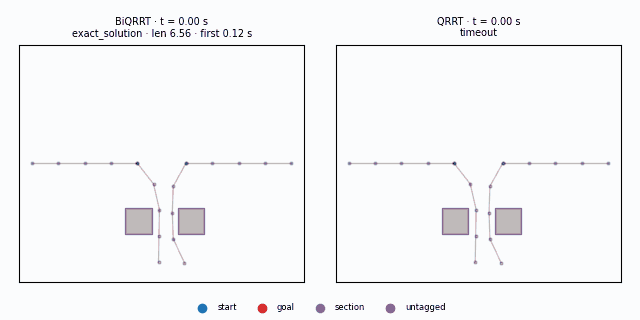

# Motion Planning Experiment



Both trees of `BiQRRT` growing through the bundle hierarchy beside `QRRT` on the same scene and
seed: blue is the start tree, red the goal tree, purple the graph vertices in neither tree —
mostly the configurations `findSection()` produces, which exist whether or not the run solved —
and opacity is the bundle level. `BiQRRT` tags its own trees; every other planner tags
nothing, so the binary derives the same `start`/`goal` labels from graph connectivity and each
frame records which of the two it is. Step it frame by frame, pick another scene, switch
between graph, vertices and path views and toggle levels in the
[trace player](https://tomsabala.github.io/MLMP/).

```sh
docker run --rm ghcr.io/tomsabala/mlmp:latest --algo BiQRRT --input-file scene1.json --time-limit 10
```

A 2D multi-robot kinematic-chain motion-planning experiment built on OMPL's
[`ompl::multilevel`](https://ompl.kavrakilab.org/multiLevelPlanning.html) bundle-space planners,
plus a custom bidirectional bundle-space planner, `BiQRRT`.

The work follows [Multilevel motion planning: A fiber bundle formulation](https://journals.sagepub.com/doi/full/10.1177/02783649231209337)
by [Andreas Orthey](https://scholar.google.com/citations?user=bQKreEMAAAAJ), Sohaib Akbar, and
[Prof. Marc Toussaint](https://scholar.google.com/citations?user=t2X4Mg8AAAAJ&hl=iw).

See [ROADMAP.md](ROADMAP.md) for where this is going.

## Usage

```
--input-file, -i   scene to plan on (required)
--time-limit, -t   planning time budget in seconds (default: 1.0)
--verbose,    -v    OMPL log output, written to stderr (default: false)
--algo,       -a   planner to run (default: BiQRRT)
--seed             RNG seed; omitted means a generated seed, reported either way
--no-simplify      skip path simplification
--trace-file       write a mlmp.trace/1 JSONL stream to this path
--trace-interval-ms  trace sampling interval (default: 50)
--trace-max-frames   stop tracing after this many frames (default: 400)
--help             print the option list
```

### Output

A run prints exactly one `mlmp.run/1` JSON object on stdout; every log line goes to stderr, so
`--verbose` never corrupts the result. The keys are `schema`, `planner`, `scene`, `scene_path`,
`robots`, `links`, `seed`, `time_limit_s`, `ompl_version`, `solved`, `exact`, `status`,
`time_solve_s`, `time_first_solution_s`, `time_simplify_s`, `solution_events`,
`path_length_raw`, `path_length_simplified`, `path_states`, `path`, `graph_vertices`,
`graph_edges`, `state_validity_checks`, `states_sampled`, `motion_checks`,
`motion_checks_valid` and `trace`.

`path` is the *simplified* path — the solver runs `simplifyMax` on the solution in place
before exporting the states, so `path` matches `path_length_simplified`, not
`path_length_raw`. `--no-simplify` skips that step, and then `path` is the raw path and
`path_length_simplified` is `null`.

A failure instead prints `{"schema":"mlmp.run/1","error":{"kind":…,"message":…}}` and exits 2,
where `kind` is `usage` (bad flags or unknown algorithm), `io` (scene or trace file unreadable)
or `runtime`. No stdout at all means the process crashed.

```sh
docker run --rm ghcr.io/tomsabala/mlmp:latest \
  --algo BiQRRT --input-file scene1.json --time-limit 10 --seed 42 | python3 -m json.tool
```

The same seed reproduces the same path (`path_length_raw`, `path_length_simplified`). It does
not reproduce the iteration counters: the multilevel planners consume the whole `--time-limit`,
so vertex, sample and check counts track host speed. `--trace-file` writes a separate JSONL
stream — one header line, then one frame per interval — described under "Track gate" in
[ROADMAP.md](ROADMAP.md). Each frame carries `tree_source` (`planner` or `derived`) and one
entry per graph vertex with `level`, `tree` (`untagged`, `start`, `goal`, or `section` for
graph vertices in neither tree), `start`/`goal` flags and a full-dimension `q`. Planners that
do not tag their own trees — everything except `BiQRRT` — get `start`/`goal` derived by a
breadth-first search from the run's start and goal vertices over the frame's own edges, and
report `tree_source: "derived"`; vertices that neither endpoint reaches stay `untagged`, and
`section` is never derived.

A *traced* run is not byte-reproducible even at a fixed seed: frame capture spends part of the
wall-clock budget and `getPlannerData` draws from the global RNG, so a `--trace-file` run's path
fields differ between invocations and from the untraced `--seed 42` numbers. The `.run.json`
files committed beside the trace fixtures in `docs/traces/` are records of one recording, not
reproducible targets.

### Algorithms

**Multilevel (bundle-space) planners** — plan on a sequence of kinematic chains of increasing
length, lifting solutions up the hierarchy:

`BiQRRT`, `QRRT`, `QRRTStar`, `QMP`, `QMPStar`

**Single-level baselines** — plan directly on the full chain:

`RRT`, `RRTConnect`, `PRMStar`, `BITStar`, `AITStar`, `EITStar`, `LBKPIECE`

The baselines are here to make `BiQRRT` results attributable: `RRT` vs. `RRTConnect` isolates
bidirectionality and `QRRT` vs. `BiQRRT` isolates it again inside the hierarchy, so a win can be
credited to the right mechanism rather than to "multilevel" in general. The asymptotically
optimal planners (`PRMStar`, `BITStar`, `AITStar`, `EITStar`) are the only honest path-length
comparison for `QRRTStar` and `QMPStar`.

### Exit codes

| Code | Meaning |
|---|---|
| 0 | A solution was found |
| 1 | No solution within the time budget |
| 2 | Usage error, unknown algorithm, or scene could not be read |

### Scene resolution

`--input-file` is used as-is when it names an existing file. Otherwise it is treated as a bare
scene name and resolved against `MLMP_SCENE_DIR`, which the image sets to `/opt/mlmp/scenes`.
Both of these work:

```sh
docker run --rm ghcr.io/tomsabala/mlmp:latest -a BiQRRT -i scene5.json -t 10
docker run --rm -v "$PWD/mlmp/src/inputs/experiment:/scenes" ghcr.io/tomsabala/mlmp:latest -i /scenes/scene1.json -t 10
```

The baked scenes are the six benchmark scenes `scene1.json`…`scene6.json`, plus the smaller
development scenes under `dev/`. Of those, BiQRRT solved `scene1` and `scene5` 3/3 at
`--time-limit 10`, while `scene4` and `scene6` were solved 0/3 by both BiQRRT and QRRT
at that budget, so expect exit 1 there. Those are stopwatch observations on one host, not a
benchmark — the real numbers are Phase 2 of the roadmap.

## Building

### Image

```sh
docker build -t mlmp:dev .
```

The builder stage compiles OMPL from source and then `mlmp`; the runtime stage carries only the
OMPL shared libraries, the `mlmp` binary and the scenes.

### Local, without Docker

```sh
cmake -S mlmp -B mlmp/build && cmake --build mlmp/build -j
```

Requires, from the distribution:

```
build-essential cmake
libboost-program-options-dev libboost-serialization-dev libboost-filesystem-dev libboost-system-dev
libeigen3-dev nlohmann-json3-dev
```

and **OMPL 1.7.0 installed from source** — no Ubuntu release ships it (noble's `libompl-dev` is
1.5.2, and `EITStar` only exists from 1.7.0 onwards):

```sh
git clone --depth 1 -b 1.7.0 https://github.com/ompl/ompl.git
cmake -S ompl -B ompl/build -DCMAKE_BUILD_TYPE=Release -DOMPL_BUILD_TESTS=OFF -DOMPL_REGISTRATION=OFF
cmake --build ompl/build --target ompl -j && sudo cmake --install ompl/build
```

The binary lands at `mlmp/build/mlmp`.

## Trace player

[`docs/`](docs/) is a static scrubber page — no build step, no dependencies — that replays the
committed fixtures for any scene with BiQRRT and QRRT side by side, steps frames, toggles
bundle levels, and switches each panel between `graph + edges`, `vertices only` and
`path only`. Each panel's caption says whether its tree colours were reported by the planner
or derived from graph connectivity, because the two panels can disagree: BiQRRT reports, QRRT
is derived. Regenerate everything after a planner change:

```sh
mlmp/tools/recordTraces.sh mlmp:dev                                  # 12 fixtures + scene copies
python3 mlmp/tools/traceGif.py --scene scene1 --out docs/biqrrt-vs-qrrt.gif
```

`recordTraces.sh` records each cell at `--seed 42 --time-limit 10 --trace-interval-ms 50`, then
packs the raw `mlmp.trace/1` stream into the `mlmp.traceviz/1` fixture under `docs/traces/` with
`mlmp/tools/packTrace.py`. The packing is not cosmetic: every trace frame re-dumps the whole
planner graph, so a raw 10 s recording is 0.3–0.9 GB, while the packed fixture is under 1.5 MB.
It stores each vertex once, truncated to the links that vertex's bundle level actually owns —
the lifted tail above the level is identity-fibre padding that changes every frame — so a frame
is just a timestamp plus a vertex and edge count.

All 12 committed fixtures — and the GIF above — were recorded with a derivation-capable image,
so the BiQRRT half carries the planner's own tags (`"tree_source": "planner"`) and the QRRT half
the labels `captureFrame` derived from graph connectivity (`"derived"`).

Re-recording rewrites the `.run.json` files beside the fixtures with new path numbers; traced
runs are not byte-reproducible (see "Output" above), so that is expected.

## Experiment harness

The old sweep script was removed together with its results: its numbers could not be
regenerated by the committed code, and it timed every planner while the others competed for
the same CPU (ROADMAP §2.1). The binary now emits machine-readable JSON per run, so a harness
reads `mlmp.run/1` from stdout instead of regexing prose. The replacement is Track B in
[ROADMAP.md](ROADMAP.md) under "Track B — Experiment harness"; `mlmp/tools/plotScene.py` is
unaffected and still renders a scene file.

[git link](https://github.com/tomsabala/MLMP)
