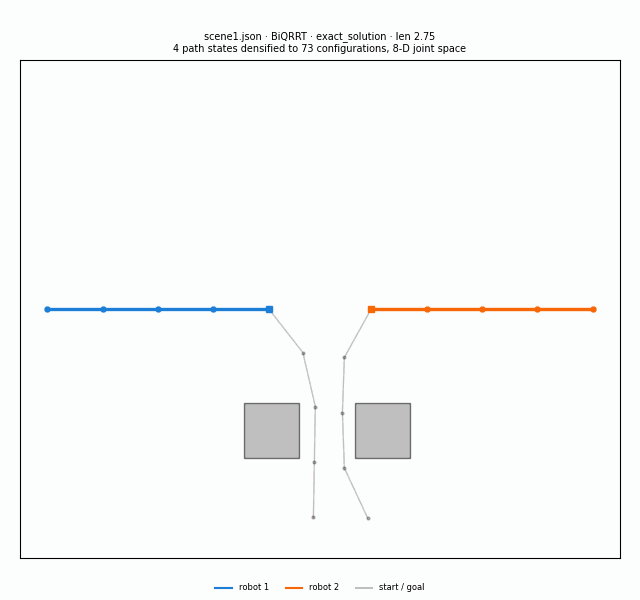

# MLMP — multilevel motion planning

**Multi-robot 2D kinematic chains and a 6-DOF UR5 arm, planned on OMPL bundle spaces by a
custom bidirectional planner — recorded, replayable, and runnable in your browser.**

- **Recorded algorithm comparison:** [Trace Explorer](https://apps.tom-sabala.dev/a/mlmp/explorer/)
  — play the solution BiQRRT found beside QRRT on the same scene and seed, then step through the
  search that produced it, one bundle level at a time, in the workspace and in the real
  configuration space.
- **Run a planner in your browser:** [Interactive Planner](https://apps.tom-sabala.dev/a/mlmp/live/)
  — the same C++ solver compiled to WebAssembly; drag an obstacle, pick one of 11 planners,
  watch the trees grow and the arms run the solution.
- Both, with a project overview: <https://apps.tom-sabala.dev/#mlmp>



The solution `BiQRRT` found on `scene1` at seed 42, played back: four simplified path states
densified to 73 configurations by the planner's own wrap-aware joint-space interpolation, with
each arm's tip trace behind it. Neither arm may touch an obstacle, the other arm, or itself —
that is the whole constraint, and it lives in eight dimensions.

A C++17 CLI on OMPL 1.7.0 that plans for teams of planar kinematic chains and for a URDF-loaded
6-DOF arm, over OMPL's [`ompl::multilevel`](https://ompl.kavrakilab.org/multiLevelPlanning.html)
bundle spaces, with `BiQRRT` — a bidirectional bundle-space planner written for this project —
against five multilevel and seven single-level baselines. The same solver compiles to
WebAssembly and runs in the browser with no server behind it.

```sh
docker run --rm ghcr.io/tomsabala/mlmp:latest --algo BiQRRT --input-file scene1.json --time-limit 10
```

The work follows [Multilevel motion planning: A fiber bundle formulation](https://journals.sagepub.com/doi/full/10.1177/02783649231209337)
by [Andreas Orthey](https://scholar.google.com/citations?user=bQKreEMAAAAJ), Sohaib Akbar, and
[Prof. Marc Toussaint](https://scholar.google.com/citations?user=t2X4Mg8AAAAJ&hl=iw).

See [ROADMAP.md](ROADMAP.md) for where this is going.

## What I implemented

OMPL 1.7.0 supplies the bundle-space machinery: `BundleSpaceSequence`, `BundleSpaceGraph`, the
projections between levels, `QRRT`/`QRRTStar`/`QMP`/`QMPStar`, the single-level baselines and
path simplification. Everything below is this repository's.

**`BiQRRT`, a bidirectional bundle-space planner** (`mlmp/src/planner/`). `QRRT` grows one tree
per bundle level outward from the start and reaches the goal through random sampling and the
level's `findSection()` lift. `BiQRRTImpl` subclasses `BundleSpaceGraph` and keeps **two**
nearest-neighbour structures per level, `treeStart_` and `treeGoal_`. Each `grow()` call swaps
the active tree, samples the bundle, clips the extension to `maxDistance_`, steers, adds the new
vertex to the active tree — and then tries to steer straight from it to its nearest neighbour in
the *other* tree. A successful steer adds that edge and marks the level solved
(`BiQRRTImpl.cpp:117-174`). Both trees exist at every level of the hierarchy, so the
bidirectional search and the multilevel decomposition compose rather than compete. Also mine:
the `vStart_` fix in `init()` — the base `init()` assigns it, the override did not, and
`getSolution()` indexes the graph with it, which was a deterministic per-scene segfault.

**Trees you can see.** `BiQRRTImpl::getPlannerData` tags every vertex the level contributed as
`start` (1), `goal` (2) or `section` (3), which is what gives the viewers their colours. No
other planner tags anything, so `Solver::captureFrame` derives the same `start`/`goal` labels
with a breadth-first search from the run's start and goal vertices over the frame's own edges,
and every frame records which of the two it was in `tree_source`. That is why the QRRT panel is
coloured at all.

**The contract and the tooling around it**: `Solver::solve(const RunOptions&) -> RunResult` with
no I/O of its own, one `mlmp.run/1` JSON object per run, the `mlmp.trace/1` JSONL recorder, the
`mlmp.traceviz/1` packer that turns a 0.3–0.9 GB raw recording into a sub-1.5 MB fixture, the
trace player, the Emscripten port and its worker-based playground, and the URDF path — a URDF
flattened to a serial chain, FCL narrowphase collision checking, and a collision step pinned to
0.02 rad because OMPL's default resolution let a 6-DOF solution contain a state its own checker
rejects.

**What this does not claim.** BiQRRT solved `scene1` and `scene5` 3/3 at a 10 s budget;
`scene4` and `scene6` were solved 0/3 by both BiQRRT and QRRT. Those are stopwatch observations
on one host, not a benchmark, and there is a known confound: `BiQRRTImpl::setup()` pins the
extension step to `0.1` when no caller sets a range, while QRRT's `SelfConfig` default measured
1.78–3.55 across `scene1`'s levels, so part of any gap may be step size rather than
bidirectionality. Turning that into a declared parameter and running a real campaign with
confidence intervals is Track F and Phase 2 of the roadmap.

## Usage

```
--input-file, -i   scene to plan on (required)
--time-limit, -t   planning time budget in seconds (default: 1.0)
--verbose,    -v    OMPL log output, written to stderr (default: false)
--algo,       -a   planner to run (default: BiQRRT)
--seed             RNG seed; omitted means a generated seed, reported either way
--no-simplify      skip path simplification
--trace-file       write a mlmp.trace/1 JSONL stream to this path
--trace-interval-ms  trace sampling interval (default: 50)
--trace-max-frames   stop tracing after this many frames (default: 400)
--help             print the option list
```

### Output

A run prints exactly one `mlmp.run/1` JSON object on stdout; every log line goes to stderr, so
`--verbose` never corrupts the result. The keys, in order, are `schema`, `planner`, `scene`,
`scene_path`, `robots`, `links`, `model`, `dof`, `robot_model`, `robot_urdf`, `seed`,
`time_limit_s`, `ompl_version`, `solved`, `exact`, `status`, `time_solve_s`,
`time_first_solution_s`, `time_simplify_s`, `solution_events`, `path_length_raw`,
`path_length_simplified`, `path_states`, `path`, `graph_vertices`, `graph_edges`,
`state_validity_checks`, `states_sampled`, `motion_checks`, `motion_checks_valid` and `trace`.
`model` is `planar` or `urdf`; `dof` is `robots × links` for planar scenes and the actuated
joint count for URDF scenes; `robot_model`/`robot_urdf` are null outside URDF runs.

`path` is the *simplified* path — the solver runs `simplifyMax` on the solution in place
before exporting the states, so `path` matches `path_length_simplified`, not
`path_length_raw`. `--no-simplify` skips that step, and then `path` is the raw path and
`path_length_simplified` is `null`.

A failure instead prints `{"schema":"mlmp.run/1","error":{"kind":…,"message":…}}` and exits 2,
where `kind` is `usage` (bad flags or unknown algorithm), `io` (scene or trace file unreadable)
or `runtime`. No stdout at all means the process crashed.

```sh
docker run --rm ghcr.io/tomsabala/mlmp:latest \
  --algo BiQRRT --input-file scene1.json --time-limit 10 --seed 42 | python3 -m json.tool
```

The same seed reproduces the same path (`path_length_raw`, `path_length_simplified`). It does
not reproduce the iteration counters: the multilevel planners consume the whole `--time-limit`,
so vertex, sample and check counts track host speed. `--trace-file` writes a separate JSONL
stream — one header line, then one frame per interval — described under "Track gate" in
[ROADMAP.md](ROADMAP.md). Each frame carries `tree_source` (`planner` or `derived`) and one
entry per graph vertex with `level`, `tree` (`untagged`, `start`, `goal`, or `section` for
graph vertices in neither tree), `start`/`goal` flags and a full-dimension `q`. Planners that
do not tag their own trees — everything except `BiQRRT` — get `start`/`goal` derived by a
breadth-first search from the run's start and goal vertices over the frame's own edges, and
report `tree_source: "derived"`; vertices that neither endpoint reaches stay `untagged`, and
`section` is never derived.

A *traced* run is not byte-reproducible even at a fixed seed: frame capture spends part of the
wall-clock budget and `getPlannerData` draws from the global RNG, so a `--trace-file` run's path
fields differ between invocations and from the untraced `--seed 42` numbers. The `.run.json`
files committed beside the trace fixtures in `docs/traces/` are records of one recording, not
reproducible targets.

### Algorithms

**Multilevel (bundle-space) planners** — plan on a sequence of kinematic chains of increasing
length, lifting solutions up the hierarchy:

`BiQRRT`, `QRRT`, `QRRTStar`, `QMP`, `QMPStar`

**Single-level baselines** — plan directly on the full chain:

`RRT`, `RRTConnect`, `PRMStar`, `BITStar`, `AITStar`, `EITStar`, `LBKPIECE`

The baselines are here to make `BiQRRT` results attributable: `RRT` vs. `RRTConnect` isolates
bidirectionality and `QRRT` vs. `BiQRRT` isolates it again inside the hierarchy, so a win can be
credited to the right mechanism rather than to "multilevel" in general. The asymptotically
optimal planners (`PRMStar`, `BITStar`, `AITStar`, `EITStar`) are the only honest path-length
comparison for `QRRTStar` and `QMPStar`.

### Exit codes

| Code | Meaning |
|---|---|
| 0 | A solution was found |
| 1 | No solution within the time budget |
| 2 | Usage error, unknown algorithm, or scene could not be read |

### Scene resolution

`--input-file` is used as-is when it names an existing file. Otherwise it is treated as a bare
scene name and resolved against `MLMP_SCENE_DIR`, which the image sets to `/opt/mlmp/scenes`.
Both of these work:

```sh
docker run --rm ghcr.io/tomsabala/mlmp:latest -a BiQRRT -i scene5.json -t 10
docker run --rm -v "$PWD/mlmp/src/inputs/experiment:/scenes" ghcr.io/tomsabala/mlmp:latest -i /scenes/scene1.json -t 10
```

The baked scenes are the six benchmark scenes `scene1.json`…`scene6.json`, plus the smaller
development scenes under `dev/`. Of those, BiQRRT solved `scene1` and `scene5` 3/3 at
`--time-limit 10`, while `scene4` and `scene6` were solved 0/3 by both BiQRRT and QRRT
at that budget, so expect exit 1 there. Those are stopwatch observations on one host, not a
benchmark — the real numbers are Phase 2 of the roadmap.

### URDF scenes

A scene whose `metadata.model` is `"urdf"` takes a parallel path: one robot, a serial chain of
actuated joints read from a URDF, 6-D joint-space planning over the same bundle hierarchy, and
FCL narrowphase collision checking. One such scene is baked into the image, `ur5_scene1.json`,
over the vendored `mlmp/src/inputs/robots/ur5.urdf` (six actuated joints):

```sh
docker run --rm ghcr.io/tomsabala/mlmp:latest -a BiQRRT -i ur5_scene1.json -t 2 --seed 42
```

Branched URDFs, meshes and prismatic joints are rejected with `error.kind == "usage"`. The
whole path is behind the `MLMP_ENABLE_URDF` CMake option (default ON; needs `liburdfdom-dev`
and `libfcl-dev`), and with it off a URDF scene exits 2. `mlmp/tools/renderUrdf.py` turns a
run's stdout into an MP4 and a GIF through MuJoCo.

## Building

### Image

```sh
docker build -t mlmp:dev .
```

The builder stage compiles OMPL from source and then `mlmp`; the runtime stage carries only the
OMPL shared libraries, the `mlmp` binary and the scenes.

### Local, without Docker

```sh
cmake -S mlmp -B mlmp/build && cmake --build mlmp/build -j
```

Requires, from the distribution:

```
build-essential cmake
libboost-program-options-dev libboost-serialization-dev libboost-filesystem-dev libboost-system-dev
libeigen3-dev nlohmann-json3-dev
```

and **OMPL 1.7.0 installed from source** — no Ubuntu release ships it (noble's `libompl-dev` is
1.5.2, and `EITStar` only exists from 1.7.0 onwards):

```sh
git clone --depth 1 -b 1.7.0 https://github.com/ompl/ompl.git
cmake -S ompl -B ompl/build -DCMAKE_BUILD_TYPE=Release -DOMPL_BUILD_TESTS=OFF -DOMPL_REGISTRATION=OFF
cmake --build ompl/build --target ompl -j && sudo cmake --install ompl/build
```

The binary lands at `mlmp/build/mlmp`.

## The hosted site

Three surfaces on one origin, served by one container image:

| Route | What it is |
|---|---|
| <https://apps.tom-sabala.dev/a/mlmp/> | Project overview (`site/`) |
| <https://apps.tom-sabala.dev/a/mlmp/explorer/> | Trace player (`docs/`) |
| <https://apps.tom-sabala.dev/a/mlmp/live/> | WebAssembly playground (`web/dist`) |

The image is built from [`docker/app/Dockerfile`](docker/app/Dockerfile) and published by
[`.github/workflows/apps-image.yml`](.github/workflows/apps-image.yml) as
`ghcr.io/tomsabala/mlmp:apps-mount-<sha>`, one immutable tag per commit. Deploying a new build
means bumping that pin in `tom-sabala.dev`'s `frontend/src/apps/apps.json`; the gateway never
builds and never follows a moving tag.

[`docs/`](docs/) is a static page — no build step, no dependencies — that replays the committed
fixtures for any scene with BiQRRT and QRRT side by side. Its default view plays the solution:
the arms themselves, interpolated in joint space by `KinematicChainSpace::interpolate`, the same
wrap-aware rule the motion validator checked each segment under. Switching to `search tree +
edges` or `search vertices` shows what the planner explored, one bundle level at a time, and a
second canvas under each panel draws the scene's 2-D bundle level as a real configuration space
with its collision region computed from the same segment-intersection predicate the C++ checker
uses. Each panel's caption says whether its tree colours were reported by the planner or derived
from graph connectivity, because the two panels can disagree: BiQRRT reports, QRRT is derived.
Regenerate everything after a planner change:

```sh
mlmp/tools/recordTraces.sh mlmp:dev                                  # 12 fixtures + scene copies
python3 mlmp/tools/traceGif.py                                       # docs/solution-motion.gif
```

`recordTraces.sh` records each cell at `--seed 42` with a per-scene budget and trace interval it
documents in a table at the top of the script, then packs the raw `mlmp.trace/1` stream into the
`mlmp.traceviz/1` fixture under `docs/traces/` with `mlmp/tools/packTrace.py`. The packing is not
cosmetic: every trace frame re-dumps the whole planner graph, so a raw 10 s recording is
0.3–0.9 GB, while the packed fixture is under 1.5 MB. It stores each vertex once, truncated to
the links that vertex's bundle level actually owns — the lifted tail above the level is
identity-fibre padding that changes every frame — so a frame is just a timestamp plus a vertex
and edge count. The solution itself is not in the packed fixture; the page reads it from the
sibling `.run.json`, which is why both files are fetched per panel.

All 12 committed fixtures — and the GIF above — were recorded with a derivation-capable image,
so the BiQRRT half carries the planner's own tags (`"tree_source": "planner"`) and the QRRT half
the labels `captureFrame` derived from graph connectivity (`"derived"`).

Re-recording rewrites the `.run.json` files beside the fixtures with new path numbers; traced
runs are not byte-reproducible (see "Output" above), so that is expected.

## Experiment harness

The old sweep script was removed together with its results: its numbers could not be
regenerated by the committed code, and it timed every planner while the others competed for
the same CPU (ROADMAP §2.1). The binary now emits machine-readable JSON per run, so a harness
reads `mlmp.run/1` from stdout instead of regexing prose. The replacement is Track B in
[ROADMAP.md](ROADMAP.md) under "Track B — Experiment harness"; `mlmp/tools/plotScene.py` is
unaffected and still renders a scene file.

[git link](https://github.com/tomsabala/MLMP)
