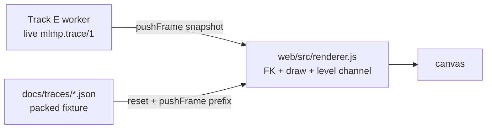

# Track A → Track E handoff

What Track A shipped, what the renderer contract still needs, and how to finish it without a
second drawing or FK implementation. Branch `track-a/trace-player`, commits `6974fd6`,
`62c0119`. Nothing here asks Track A for more solver work: every field Track E needs is in
`mlmp.trace/1` as emitted today.

Verdict up front: **Track A landed page-shaped, not module-shaped.** `docs/app.js` has no
exports and resolves ten elements by id. Track E implements `web/src/renderer.js` to its own
signature and Track A adopts it — the fallback the Track E card already names.

## 1. What exists

| File | What it is |
|---|---|
| `mlmp/src/planner/src/BiQRRTImpl.cpp:166-208` | `getPlannerData` tags every vertex it appends via `PlannerDataVertexAnnotated::setComponent` |
| `mlmp/src/models/run_result.h:91-99` | `treeLabel(component)` — the tag vocabulary, defined once |
| `mlmp/src/models/solver.h:394-415` | `captureFrame`, the only place a trace frame is built |
| `.github/workflows/ci.yml` "Trace contract" | asserts frame shape, `q` dimension, and that BiQRRT leaves nothing untagged |
| `mlmp/tools/recordTraces.sh` | records the 12 committed fixtures (`--seed 42 --time-limit 10 --trace-interval-ms 50`) and packs them |
| `mlmp/tools/packTrace.py` | `mlmp.trace/1` → `mlmp.traceviz/1`; **read its module docstring before designing storage** |
| `mlmp/tools/traceGif.py` | README GIF; Python copy of the FK and the drawing rules |
| `docs/index.html`, `docs/app.js`, `docs/style.css` | the scrubber page; no build step, no dependencies |
| `docs/traces/*.json`, `docs/scenes/*.json` | 12 packed fixtures (0.74–1.37 MB each) + scene copies |

## 2. The data Track E will receive

### 2.1 Frame vertex

`mlmp.trace/1` is one header line then one frame per interval. A frame is
`{frame, t_s, vertices[], edges[]}`; `edges` are `[i, j]` index pairs into that frame's
`vertices`. A vertex is:

```json
{"level": 2, "component": 1, "tree": "start", "start": false, "goal": false, "q": [...]}
```

- `level` — bundle level that owns this vertex.
- `component` / `tree` — tag, see §2.3. Both are always present; `tree` is the string form.
- `start` / `goal` — `PlannerData::isStartVertex` / `isGoalVertex`, not tree membership.
- `q` — **always full dimension** (`robots * links`), interleaved `q[link * robots + robot]`.

### 2.2 Every frame is a complete cumulative snapshot, not a delta

Two consequences, both load-bearing:

- **Do not accumulate pushed frames.** Retaining them is why a raw 10 s recording is
  0.3–0.9 GB (measured, all 12 cells). Render the latest snapshot and drop it.
- A scrubber is still expressible on a push-only API: seek to *k* is `reset()` then
  `pushFrame(snapshot_k)`. Track A's current `drawFrame` already redraws the whole prefix on
  every repaint, so replay costs nothing extra.

### 2.3 Tag vocabulary — four values, not two

Fixed in `treeLabel` and nowhere else. No renderer may test a planner name.

| `component` | `tree` | Meaning |
|---|---|---|
| 0 | `untagged` | any planner that is not BiQRRT — verified: QRRT emits this for all 14 k vertices |
| 1 | `start` | start tree |
| 2 | `goal` | goal tree |
| 3 | `path` | OMPL-injected solution-path state (`BundleSpaceGraph.cpp:804-823`), **not a tree** |

Treat unknown or missing as `untagged` and the "keep it optional" requirement is met.

### 2.4 FK must truncate to the vertex's level

`computeRobotSegments` (`mlmp/src/state/kinematic_chain.h:199-222`) draws all `N` links, which
is correct for a *configuration* and wrong for a *bundle vertex*. Everything above
`link > level` is identity-fibre padding re-derived from the planner's current section every
frame — not planner output.

Measured on `scene1`/QRRT: 14 230 graph vertices, **2 296 535 distinct full `q` vectors** across
196 frames. Truncated to the owned prefix, the count is exactly 14 230. The padding was all of
the churn. Draw the untruncated tail and you render a jittering artefact that belongs to no one.

The rule, for robot `r` at level `L`, starting at `pinnedPosition` with `theta = 0`:

```
for j in 0..L:  theta += q[j * robots + r];  x += jointLength * cos(theta);  y += ... sin(theta)
```

Plot the resulting **tip**, one dot per robot. Reference implementations:
`docs/app.js:64` (`chainTips`) and `mlmp/tools/traceGif.py:49`.

### 2.5 Packed fixtures — only if Track E wants the committed recordings

`mlmp.traceviz/1` (`docs/traces/<scene>-<planner>.json`) exists because raw streams cannot be
served from Pages or committed. It stores every vertex and edge once in first-appearance order,
each vertex truncated to its owned prefix, and each frame as `[t_s, vertexCount, edgeCount]` —
frame *k* is `vertices[:nv]` / `edges[:ne]`. `packTrace.py` asserts append-only monotonicity and
aborts rather than dropping data. Fields: `robots`, `links`, `interval_ms`, `tree_codes`, `run`
(an `mlmp.run/1` subset for captions), `vertices`, `edges`, `frames`.

Track E's live stream does not need this format. It is listed so the same renderer can drive
both: materialise a prefix into a snapshot and push it.

## 3. Contract status

Against the Track E renderer contract:

| Clause | Status | Note |
|---|---|---|
| `createTracePlayer({canvas, scene})` module | ✗ | `docs/app.js` exports nothing; ids at lines 22–35, listeners at 356–367; assumes two fixed canvases |
| `pushFrame(frame)` incremental | ✗ | random-access over a whole fixture; slider needs the frame count up front |
| `setScene(scene)` | ✗ API, ✓ mechanism | `loadScene(name)` takes a *name* and refetches. Geometry is already a separate input and extents come from the scene, not frames (`sceneBounds`, `app.js:99`) |
| FK in the renderer, one copy | ⚠ | `app.js:64` is the JS copy; `traceGif.py:49` is a necessary Python copy for the GIF. Refuse a *third* JS copy |
| Level as a visual channel | ✓ | `alpha = 0.35 + 0.65 * level / maxLevel` plus `L0…Ln` filters. Unchecking `L3` on scene1 drops painted pixels 192 280 → 77 542 |
| Tree tagging, optional | ✓ | shipped; see §2.3 |
| `showPath(path)` from `mlmp.run/1` | ✗ | new work in either track — nothing committed draws the run's `path` array. Green today is `component == 3`, a different thing |
| `reset()` / `destroy()` | ✗ | state is one module-level singleton |

## 4. Guidance for finishing it

### 4.1 Lift these out of `docs/app.js` verbatim

They are already frame-independent and DOM-free apart from the `ctx` argument:

| Function | Line | Keep as |
|---|---|---|
| `chainTips` | 64 | the FK — the one copy |
| `chainJoints` | 84 | start/goal arm geometry (scene angles are **integer degrees**) |
| `sceneBounds` | 99 | fixed extents from obstacles + `links * jointLength` reach, padding `0.05` |
| `projector` | 150 | equal-aspect scene→pixel map, y flipped |
| `drawStatic` | 160 | obstacles + faint start/goal arms |
| `drawFrame` | 197 | vertices and edges; keep the `path`-last z-order |
| `hexToRgba`, `TREE_COLORS`, `PADDING` | 14, 20, 51 | the palette |

What must **not** come across: `el`, `panels`, `state`, `render`, `setFrame`,
`buildLevelToggles`, `loadScene`, `tick` — those are the page.

### 4.2 Rendering rules the module must preserve

They are currently duplicated between `app.js` and `traceGif.py`; whatever ships must keep GIF
and page in agreement.

- Colour = tree, opacity = level: `alpha = 0.35 + 0.65 * level / max(1, links - 1)`.
- `start` `#1f77b4`, `goal` `#d62728`, `path` `#2ca02c`, `untagged` `#7f7f7f`.
- Dot radius 2.4 for `path`, 1.5 otherwise; `path` drawn last.
- Edges: one segment per robot between the two endpoints' tips, each endpoint using **its own**
  level, alpha 0.25, coloured by the source vertex.
- Extents fixed across all frames from the scene, never renormalised per frame — a renderer that
  rescales as the cloud grows cannot be scrubbed or compared.

### 4.3 Shape of the module

- `pushFrame(frame)` takes a raw `mlmp.trace/1` frame object and renders it as the current
  state. Precompute per-vertex tips/colour on push; do not retain previous frames.
- `setScene(scene)` recomputes `sceneBounds` and the static layer, then redraws. Track A's
  per-scene `links` comes from the trace header; take it from the scene's `metadata.n` instead
  so the renderer does not depend on a header it may not have yet.
- `reset()` clears vertices, edges and cached extents but keeps the canvas and the scene.
- `showPath(path)` is new: `path` from `mlmp.run/1` is an array of joint vectors at **full**
  dimension (no level truncation — these are real configurations), so draw them with the full
  `computeRobotSegments` FK, i.e. whole arms, not tips. This is the one place the untruncated FK
  is the correct one. Keep it visually distinct from `component == 3` vertices.
- Level visibility: expose a setter rather than reading checkboxes; the page owns the controls.

### 4.4 Retrofitting Track A onto it

Once `web/src/renderer.js` exists, `docs/app.js` keeps scene selection, play/pause, slider,
level checkboxes and captions, and replaces its drawing with
`reset()` + `pushFrame(snapshotFromPackedPrefix(k))`. Materialising a snapshot from
`mlmp.traceviz/1` is a slice of `vertices` and `edges`; note those vertices are **already
truncated**, so the shared `chainTips` must stay tolerant of a short `q` (it is — it breaks when
the index runs past the array).

Reconciled, there is one drawing path and one JS FK:



### 4.5 Parity check for the GIF

`traceGif.py` cannot import the JS module, so its Python FK stays a second implementation.
Budget a cheap check instead of pretending otherwise: render one frame both ways for `scene1`
and compare tip coordinates, or assert the shared constants (`TREE_COLORS`, `PADDING`, the alpha
formula) match. Do not let the two drift silently.

## 5. Things that will bite

- **Never assert `path_length_raw >= path_length_simplified`.** The custom angle-wrapping
  distance is not additive along interpolation (`CLAUDE.md`, `kinematic_chain.h`).
- **Scene angles are integer degrees** in the JSON, radians everywhere in `q`.
- **`plotScene.py:65` uses `padding = 1`** — ten unit-squares wide. The renderers use `0.05`.
- **Tracing costs throughput.** `scene5`/BiQRRT timed out in one recording batch and solved at
  1.05 s in the next, same seed, same budget. Captions must report what the recording did; never
  infer solved-ness from frame contents.
- **QRRT panels are honest failures** (`timeout`, one grey cloud) and stay that way until
  Track F touches `maxDistance_`. Re-recording is `recordTraces.sh` + `traceGif.py`, nothing else.
- **`component` was constant 0 before this track.** `ompl::multilevel` never calls `setComponent`
  anywhere; it was free real estate. Any fixture or trace recorded before `6974fd6` has no tags.
